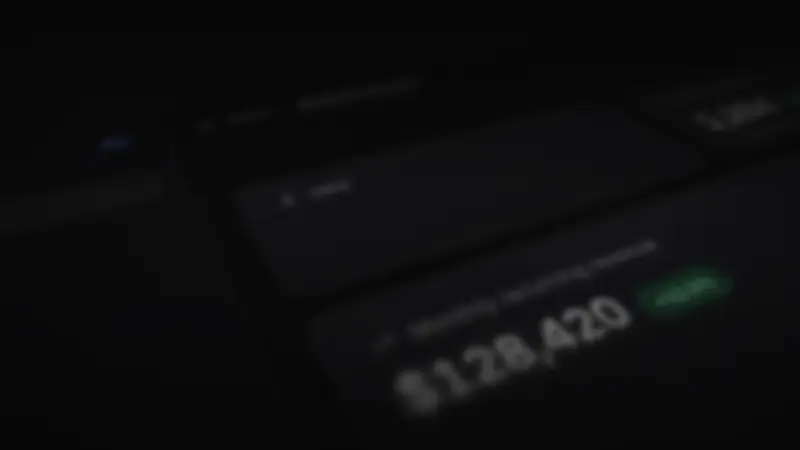
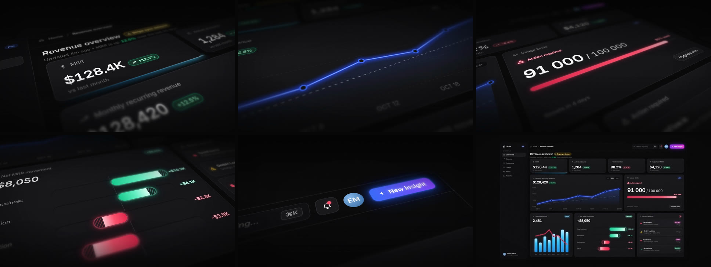

<div align="center">

# Skills Motion Design

**Des skills Claude qui transforment une interface produit en vidéo motion design prête à publier.**<br>
Un skill par style de montage : image, rythme, caméra, musique et effets sonores compris.

[Installation](docs/installation.md) · [Utilisation](docs/utilisation.md) · [Modèles de prompts](docs/prompts.md) · [Dépannage](docs/depannage.md) · [Nouveautés](CHANGELOG.md)



<sub>Film d'exemple généré par le skill <code>dashboard-cinematique</code>, sans retouche (marque et données fictives).<br>
<a href="docs/media/exemple.mp4"><b>Voir la vidéo complète avec le son</b></a> · MP4 1080p · 19 s</sub>

</div>

---

## Les skills

| Skill | Style | Idéal pour | Version |
|---|---|---|---|
| [**dashboard-cinematique**](skills/dashboard-cinematique/SKILL.md) | Interface SaaS sombre filmée en macro sur un plan 3D incliné, profondeur de champ courte, accents néon, plans de 3 s en coupe franche, recul final sur l'interface entière. Musique électro entraînante avec « drop » sur la 1re coupe et effets d'interface (tics, bloops, verre, whoosh) calés automatiquement sur chaque animation ; profil « cinéma » sombre en option. | SaaS, applications web, back-offices, outils d'analyse, fintech : vidéo de lancement, page d'accueil, publicité, LinkedIn | 1.3.0 |

D'autres styles suivront, chacun dans son propre dossier de `skills/`.

## Ce que vous obtenez

Vous décrivez votre produit et vous joignez des captures de votre interface. Claude reconstruit l'interface en code, la filme comme un objet et livre :

- **une vidéo MP4** en 1920×1080, 30 images/s, d'environ 20 s (4K en option) ;
- **5 plans rapprochés de 3 s**, un élément de l'interface par plan (chiffre clé, courbe, alerte, graphique, bouton), puis un **recul** sur le tableau de bord complet ;
- **une bande-son originale** composée pour le montage : intro calme puis « drop » sur la 1re coupe, électro entraînante, et des effets d'interface (tics, bloops, tintements, whoosh) posés automatiquement sur chaque animation, à l'image près ;
- **le projet source** ([Remotion](https://www.remotion.dev)), pour modifier un chiffre, un plan ou la musique et relancer le rendu ;
- sur demande, une **version « effets sonores seuls »** pour ajouter un son tendance sur TikTok ou Reels.



<sub>Les six temps du film : ouverture sur un KPI, courbe qui se trace, alerte, graphique à barres, bouton d'action, recul final.</sub>

## Démarrage rapide

### 1. Installer

**Claude Code** (recommandé) : dans une session, tapez :

```text
/plugin install motion-design --marketplace lrodrigues-cyber/Skills-motion-design
```

Sur une version de Claude Code antérieure à 2.1.275, utilisez les deux commandes :

```text
/plugin marketplace add lrodrigues-cyber/Skills-motion-design
/plugin install motion-design@motion-design-skills
```

**claude.ai** : téléchargez [`dist/dashboard-cinematique.zip`](dist/dashboard-cinematique.zip), puis ouvrez **Customize › Skills**, cliquez sur **+**, puis **Create skill › Upload a skill** et choisissez l'archive. L'exécution de code doit être activée (**Settings › Capabilities**).

Les autres méthodes (dossier personnel, projet d'équipe, Windows) sont détaillées dans le [guide d'installation](docs/installation.md).

### 2. Demander une vidéo

Joignez des captures de votre dashboard et envoyez :

```text
Avec le skill dashboard-cinematique, crée une vidéo motion design de mon dashboard
à partir des captures jointes. Choisis les 5 plans les plus forts, garde mes vrais
chiffres, pas de logo à la fin. Montre-moi un brouillon avant le rendu final.
```

Pour un résultat précis, utilisez le [modèle de brief complet](docs/prompts.md#1-le-brief-complet-recommandé).

### 3. Valider le brouillon, puis lancer le rendu final

Claude rend d'abord un brouillon en demi-résolution (5 à 10 min) et vérifie lui-même la fluidité et la netteté. Vous demandez vos retouches, puis il lance le rendu final (environ 30 min sur un ordinateur à 4 cœurs). Le déroulé complet est décrit dans le [guide d'utilisation](docs/utilisation.md).

## Prérequis

| | Minimum | Conseillé |
|---|---|---|
| Environnement Claude | Claude Code ou claude.ai avec l'exécution de code activée | **Claude Code** (terminal, application de bureau ou extension IDE) |
| Node.js | 18 | 20 ou 22 (LTS) |
| ffmpeg | Pour les contrôles automatiques et la recompression | Installé et accessible dans le terminal |
| Machine | 4 cœurs, 8 Go de RAM, 1,5 Go d'espace libre par projet | 8 cœurs ou plus, 16 Go de RAM |
| Réseau | Au premier lancement : paquets npm et Chrome Headless Shell (téléchargés automatiquement) | |

## Documentation

| Guide | Contenu |
|---|---|
| [Installation](docs/installation.md) | Les 4 méthodes d'installation, la vérification, les mises à jour |
| [Utilisation](docs/utilisation.md) | Ce qu'il faut préparer, le déroulé d'une commande, ce qui est réglable, les bonnes pratiques |
| [Modèles de prompts](docs/prompts.md) | Brief complet, brief express, à partir du code, retouches image et son, livraison |
| [Dépannage](docs/depannage.md) | Questions fréquentes et solutions aux erreurs courantes |
| [Recette du style](skills/dashboard-cinematique/SKILL.md) | Les règles que Claude applique (lecture facultative) |
| [Analyse des références](skills/dashboard-cinematique/references/analyse-references.md) | Décorticage plan par plan, image et son, des vidéos qui ont servi de modèle |

## Structure du dépôt

```text
.
├── .claude-plugin/
│   └── marketplace.json        catalogue du plugin « motion-design » pour Claude Code
├── skills/
│   └── dashboard-cinematique/  le skill (lu par Claude)
│       ├── SKILL.md            la recette du style et la méthode de travail
│       ├── references/         analyse des vidéos de référence, recette du son
│       ├── scripts/            création d'un projet vidéo
│       └── assets/template/    projet Remotion complet : interface, caméra, film d'exemple, bande-son
├── dist/
│   └── dashboard-cinematique.zip   archive prête à importer dans claude.ai
├── docs/                       guides d'installation et d'utilisation, modèles de prompts
└── outils/empaqueter.sh        reconstruit les archives de dist/
```

## Licences et crédits

- **Musique et effets sonores** : générés par le script du skill (`bande-son.mjs`). Ils ne contiennent aucun échantillon ni aucune boucle tierce.
- **Police Inter** : SIL Open Font License 1.1 ([licence incluse](skills/dashboard-cinematique/assets/template/public/fonts/OFL-Inter.txt)).
- **Remotion** : gratuit pour les particuliers et les entreprises de 3 personnes au plus. Au-delà, une [licence entreprise](https://www.remotion.dev/license) est nécessaire pour rendre des vidéos.
- **Marque « Nova » et données du film d'exemple** : fictives, à remplacer par les vôtres.
- Les vidéos de référence analysées pour construire le style ne sont pas distribuées dans ce dépôt.

## Contribuer

Les suggestions et les nouveaux styles sont les bienvenus. La marche à suivre est dans [CONTRIBUTING.md](CONTRIBUTING.md).
